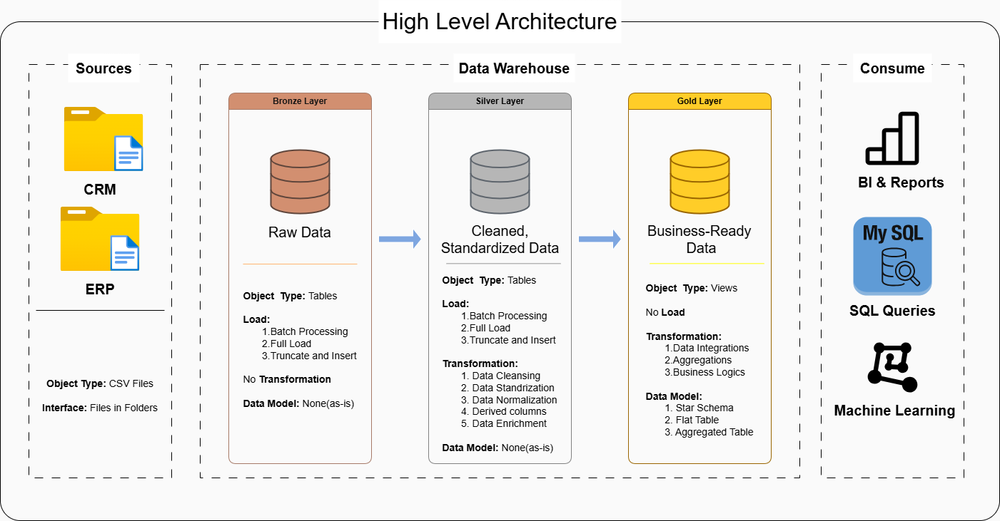
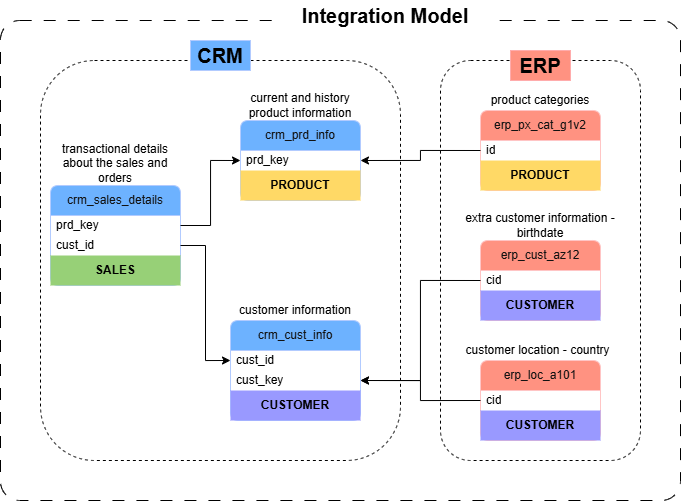
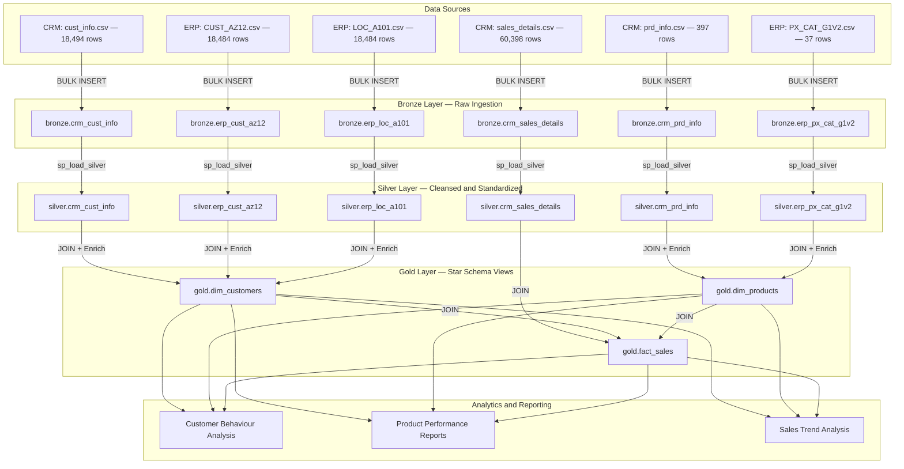
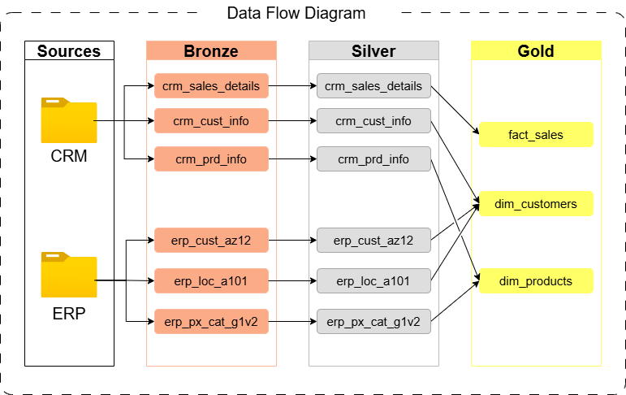

# 🏗️ SQL Data Warehouse & Analytics Project

> An end-to-end data warehousing solution built on Microsoft SQL Server that implements the **Medallion Architecture** (Bronze → Silver → Gold) to transform raw operational CSV data from CRM and ERP systems into a clean, analytics-ready **Star Schema** for business intelligence and reporting.

[](LICENSE)


---

## 📋 Table of Contents

1. [Project Overview](#-project-overview)
2. [Architecture](#-architecture)
3. [System Workflow](#-system-workflow)
4. [Technology Stack](#-technology-stack)
5. [Dataset Description](#-dataset-description)
6. [Data Model – Gold Layer](#-data-model--gold-layer)
7. [ETL Pipeline Details](#-etl-pipeline-details)
8. [Data Quality Checks](#-data-quality-checks)
9. [Project Directory Structure](#-project-directory-structure)
10. [Prerequisites](#-prerequisites)
11. [Installation & Setup](#-installation--setup)
12. [How to Run the Project](#-how-to-run-the-project)
13. [Analytical Use Cases](#-analytical-use-cases)
14. [Limitations & Future Improvements](#-limitations--future-improvements)
15. [Troubleshooting](#-troubleshooting)
16. [License](#-license)
17. [About the Author](#-about-the-author)

---

## 📌 Project Overview

### Problem Statement

Organizations often operate multiple independent systems — such as CRM (Customer Relationship Management) and ERP (Enterprise Resource Planning) platforms — each storing data in different formats, with different naming conventions, and with inconsistent or missing values. Analysts trying to answer business questions must manually reconcile these systems, which is error-prone and time-consuming.

### Proposed Solution

This project builds a **centralized data warehouse** using **Microsoft SQL Server** that:

1. **Ingests** raw CSV exports from both a CRM system and an ERP system into a Bronze (raw) layer.
2. **Cleans and standardizes** the data in a Silver (curated) layer using ETL stored procedures.
3. **Integrates** the cleaned data into a Gold (analytics-ready) layer modeled as a **Star Schema** with dimension and fact views.
4. **Validates** data quality at each layer using automated SQL quality-check scripts.

### Target Audience & Applications

| Audience | Application |
|---|---|
| Data Analysts | Run analytical queries directly against Gold layer views |
| BI Developers | Connect reporting tools (Power BI, Tableau) to the Gold layer |
| Data Engineers | Study the Medallion Architecture ETL pattern |
| Students / Portfolio Reviewers | Understand end-to-end data warehouse implementation in SQL |

### Key Objectives

- Demonstrate the **Medallion Architecture** (Bronze → Silver → Gold) in a real SQL Server environment.
- Implement **ETL transformation logic** as reusable SQL stored procedures.
- Model business data as a **Star Schema** (1 fact table + 2 dimension tables).
- Enforce **data quality** with automated validation queries at both the Silver and Gold layers.
- Provide clear **documentation** for both technical and business stakeholders.

---

## 🏛️ Architecture

The project follows the **Medallion Data Architecture**, a layered data design pattern where data quality and usability improve progressively through each layer.



| Layer | Schema | Purpose | Data State |
|---|---|---|---|
| **Bronze** | `bronze` | Raw ingestion from source CSV files | Unmodified, as-is from source |
| **Silver** | `silver` | Cleaned, standardized, and validated data | Transformed, deduplicated |
| **Gold** | `gold` | Business-ready analytics views (Star Schema) | Integrated, enriched, query-optimized |

The **integration model** below illustrates how the six source tables across the two systems are joined and integrated into the Gold layer:



---

## 🔄 System Workflow

The complete end-to-end data flow from raw source files to analytics-ready output:



### Execution Order

```
1. scripts/init_database.sql          → Create the DataWarehouse database and schemas
2. scripts/bronze/DDL_bronze.sql      → Create Bronze layer tables
3. scripts/bronze/sp_load_bronze.sql  → Load raw CSV data into Bronze tables (BULK INSERT)
4. scripts/silver/DDL_silver.sql      → Create Silver layer tables
5. scripts/silver/sp_load_silver.sql  → Clean and transform data from Bronze → Silver
6. scripts/gold/DDL_gold.sql          → Create Gold layer views (Star Schema)
7. test/quality_checks_silver.sql     → (Optional) Validate Silver layer data quality
8. test/quality_checks_gold.sql       → (Optional) Validate Gold layer integrity
```

---

## 🛠️ Technology Stack

| Technology | Version | Role in Project |
|---|---|---|
| **Microsoft SQL Server** | 2019+ | Primary database engine hosting all three layers |
| **T-SQL (Transact-SQL)** | — | DDL definitions, stored procedures, views, quality checks |
| **SQL Server Management Studio (SSMS)** | 19+ | IDE for executing scripts and querying the warehouse |
| **BULK INSERT** | — | Efficiently loads large CSV files into Bronze tables |
| **Stored Procedures** | — | Encapsulate and automate the Bronze→Silver ETL steps |
| **SQL Views** | — | Implement the Gold layer as queryable virtual tables |
| **Draw.io** | — | Architecture and data flow diagram design |
| **CSV** | — | Raw source data format for both CRM and ERP datasets |
| **Git / GitHub** | — | Version control and project hosting |

---

## 📂 Dataset Description

The project uses **six CSV source files** split across two simulated source systems. All CSV files are included in the repository under `datasets/`.

> **Note:** The CSV files contain sales data resembling the AdventureWorks sample dataset structure (a fictional bicycle manufacturer), used here for educational and portfolio purposes.

### Source System 1: CRM

Located in `datasets/source_crm/`

| File | Rows | Columns | Description |
|---|---|---|---|
| `cust_info.csv` | 18,494 | 7 | Customer master data: ID, name, marital status, gender, creation date |
| `prd_info.csv` | 397 | 7 | Product catalogue: ID, key, name, cost, product line, date range |
| `sales_details.csv` | 60,398 | 9 | Sales transactions: order number, product key, customer ID, dates, sales, quantity, price |

**Known raw data issues in CRM files:**

| Column | Raw Format | Issue |
|---|---|---|
| `cst_id` | INT | Some NULL values present |
| `cst_firstname` / `cst_lastname` | NVARCHAR | Leading/trailing whitespace |
| `cst_marital_status` | `'M'` or `'S'` | Needs expansion to `'Married'` / `'Single'` |
| `cst_gndr` | `'M'` or `'F'` | Needs expansion to `'Male'` / `'Female'` |
| `sls_order_dt` / `sls_ship_dt` / `sls_due_dt` | INT (YYYYMMDD) | Some invalid/zero values needing NULL conversion |
| `sls_sales` | INT | Inconsistencies with `quantity × price`; recalculated in Silver |
| `prd_line` | `'M'`, `'R'`, `'S'`, `'T'` | Needs expansion to full product line names |
| `prd_cost` | INT | Some NULL values (replaced with `0`) |

### Source System 2: ERP

Located in `datasets/source_erp/`

| File | Rows | Columns | Description |
|---|---|---|---|
| `CUST_AZ12.csv` | 18,484 | 3 | Supplementary customer demographics: ID, birth date, gender |
| `LOC_A101.csv` | 18,484 | 2 | Customer location data: ID, country |
| `PX_CAT_G1V2.csv` | 37 | 4 | Product category and subcategory taxonomy |

**Known raw data issues in ERP files:**

| Column | Raw Format | Issue |
|---|---|---|
| `cid` (CUST_AZ12) | NVARCHAR | Prefixed with `'NAS'` — stripped during Silver load |
| `cid` (LOC_A101) | NVARCHAR | Contains underscores (e.g., `AW_00011000`) — removed in Silver |
| `bdate` | DATE | Some future birth dates — set to NULL in Silver |
| `gen` | Mixed (`'M'`, `'F'`, `'Male'`, `'Female'`) | Non-uniform — standardized in Silver |
| `cntry` | Abbreviated codes (`'DE'`, `'US'`, `'USA'`) | Expanded to full country names in Silver |

### Data Integration Strategy

The CRM system is treated as the **primary (master) source**. When data conflicts arise between CRM and ERP (e.g., gender recorded differently in both), the CRM value takes precedence. ERP values are used as fallback only when the CRM value is missing or `'N/A'`.

---

## 📊 Data Model – Gold Layer

The Gold layer implements a **Star Schema** using three SQL **Views** (not physical tables). Views are computed from Silver data at query time.



### Star Schema Structure

```
                 ┌────────────────────────┐
                 │   gold.dim_customers   │
                 │────────────────────────│
                 │ customer_key  (SK/PK)  │
                 │ customer_id            │
                 │ customer_number        │
                 │ customer_first_name    │
                 │ customer_last_name     │
                 │ customer_country       │
                 │ gender                 │
                 │ marital_status         │
                 │ birthdate              │
                 │ creation_date          │
                 └──────────┬─────────────┘
                            │ customer_key (FK)
                            ▼
  ┌───────────────────┐   ┌───────────────────────┐
  │ gold.dim_products │   │   gold.fact_sales      │
  │───────────────────│   │───────────────────────│
  │ product_key (SK)  │◄──│ order_number           │
  │ product_id        │   │ product_key  (FK)      │
  │ product_number    │   │ customer_key (FK)      │
  │ product_name      │   │ order_date             │
  │ category_id       │   │ shipping_date          │
  │ category_name     │   │ due_date               │
  │ subcategory_name  │   │ sales_amount           │
  │ maintenance       │   │ quantity               │
  │ product_cost      │   │ price                  │
  │ product_line      │   └───────────────────────┘
  │ start_date        │
  └───────────────────┘
```

### View Definitions Summary

| View | Source Tables Joined | Key Transformations |
|---|---|---|
| `gold.dim_customers` | `silver.crm_cust_info` + `silver.erp_cust_az12` + `silver.erp_loc_a101` | Surrogate key via `ROW_NUMBER()`, gender consolidation (CRM master), LEFT JOINs for demographics and location |
| `gold.dim_products` | `silver.crm_prd_info` + `silver.erp_px_cat_g1v2` | Surrogate key, category enrichment via JOIN, filters historical products (`WHERE prd_end_dt IS NULL`) |
| `gold.fact_sales` | `silver.crm_sales_details` + `gold.dim_products` + `gold.dim_customers` | Resolves business keys to surrogate keys from dimension views |

> **Design note:** Surrogate keys in Gold views are generated with `ROW_NUMBER() OVER (ORDER BY ...)` at query time. They are not persisted in physical tables, so they remain consistent across joins within a single query but may shift if the underlying Silver data changes between runs.

---

## ⚙️ ETL Pipeline Details

### Bronze Layer – Raw Ingestion

**Script:** `scripts/bronze/sp_load_bronze.sql`

The stored procedure `bronze.load_bronze` loads all six CSV files using `BULK INSERT`. Each table is **truncated** before loading (full refresh pattern).

Key implementation details:

- Uses `FIRSTROW = 2` to skip CSV header rows.
- Uses `FIELDTERMINATOR = ','` for comma-delimited parsing.
- Wraps all operations in `TRY...CATCH` for structured error reporting.
- Prints individual table load duration and total batch duration in seconds.
- Sales dates are stored as `INT` (raw YYYYMMDD format) in Bronze — intentionally left for Silver to convert.

> **Important:** The `BULK INSERT` paths in `sp_load_bronze.sql` currently contain the original developer's absolute file paths. These **must be updated** to match your environment before running. See [Installation & Setup](#-installation--setup) for details.

### Silver Layer – Cleansing & Standardization

**Script:** `scripts/silver/sp_load_silver.sql`

The stored procedure `silver.load_silver` reads from Bronze tables, applies transformations, and inserts into Silver tables (also truncated before each load):

| Table | Transformations Applied |
|---|---|
| `crm_cust_info` | `TRIM()` whitespace from names; expand coded marital status and gender to full words; deduplicate via `ROW_NUMBER() OVER (PARTITION BY cst_id ORDER BY cst_create_date DESC)` — keeps only the most recent record per customer |
| `crm_prd_info` | Extract `cat_id` from `prd_key` substring for ERP category JOIN; expand product line codes to full names; replace NULL `prd_cost` with `0`; compute `prd_end_dt` using `LEAD()` window function |
| `crm_sales_details` | Convert INT-encoded dates (YYYYMMDD) to `DATE` type; nullify invalid/zero dates; recalculate `sls_sales` when inconsistent with `quantity × ABS(price)` |
| `erp_cust_az12` | Strip `'NAS'` prefix from customer IDs; nullify future birth dates; standardize gender to `'Male'` / `'Female'` / `'N/A'` |
| `erp_loc_a101` | Remove underscores from customer IDs; expand country abbreviations to full names; default blank/NULL countries to `'N/A'` |
| `erp_px_cat_g1v2` | Loaded as-is — no data quality issues identified in source |

### Gold Layer – Star Schema Views

**Script:** `scripts/gold/DDL_gold.sql`

Unlike Bronze and Silver which use physical tables, the **Gold layer uses SQL Views**:

- No data is duplicated — views read Silver tables at query time.
- Schema changes in Silver automatically reflect in Gold views on next query.
- No separate load step is required — executing `DDL_gold.sql` creates or replaces all three views.

---

## ✅ Data Quality Checks

Two standalone query scripts validate the pipeline. They are run manually after each layer is loaded.

### Silver Layer Checks

**Script:** `test/quality_checks_silver.sql`

Compares Bronze (raw) vs Silver (cleaned) for 15+ validation tests:

| Check | Table | Expected Silver Result |
|---|---|---|
| NULL primary key | `crm_cust_info` | Zero rows |
| Duplicate customer ID | `crm_cust_info` | Zero rows |
| Leading/trailing spaces in names | `crm_cust_info` | Zero rows |
| Marital status values | `crm_cust_info` | Only `'Married'`, `'Single'`, `'N/A'` |
| Gender values | `crm_cust_info`, `erp_cust_az12` | Only `'Male'`, `'Female'`, `'N/A'` |
| NULL or negative product cost | `crm_prd_info` | Zero rows |
| Product line standardization | `crm_prd_info` | Only full names |
| Duplicate product keys | `crm_prd_info` | Zero rows |
| Invalid date formats | `crm_sales_details` | Zero rows |
| Sales amount consistency | `crm_sales_details` | `sales = quantity × price` |
| Invalid price or quantity | `crm_sales_details` | Zero rows |
| `'NAS'` prefix in ERP customer IDs | `erp_cust_az12` | Zero rows |
| Future birth dates | `erp_cust_az12` | Zero rows |
| Invalid gender values | `erp_cust_az12` | Zero rows |
| Country code standardization | `erp_loc_a101` | Only full country names |

### Gold Layer Checks

**Script:** `test/quality_checks_gold.sql`

| Check | Description | Expected Result |
|---|---|---|
| Duplicate customer records | Verifies the dimension JOIN produces unique customer records | Zero rows |
| Gender conflict resolution | Validates CRM gender used as primary, ERP as fallback | Review output |
| Referential integrity | Identifies sales with no matching product in `dim_products` | Zero rows |
| Dimension final validation | Queries the complete dimension views for visual inspection | Clean records |

---

## 📁 Project Directory Structure

```
sql-data-warehouse-project/
│
├── datasets/                          # Source CSV data files
│   ├── source_crm/                    # CRM system exports
│   │   ├── cust_info.csv              # Customer master data (18,494 rows)
│   │   ├── prd_info.csv               # Product catalogue (397 rows)
│   │   └── sales_details.csv          # Sales transactions (60,398 rows)
│   │
│   └── source_erp/                    # ERP system exports
│       ├── CUST_AZ12.csv              # Customer demographics (18,484 rows)
│       ├── LOC_A101.csv               # Customer location/country (18,484 rows)
│       └── PX_CAT_G1V2.csv           # Product categories & subcategories (37 rows)
│
├── docs/                              # Project documentation and diagrams
│   ├── data_catalog.md                # Gold layer data dictionary (column descriptions)
│   ├── data_flow_diagram.png          # Star Schema / data flow visualization
│   ├── data_flow_diagram.drawio       # Editable Draw.io source for data flow diagram
│   ├── high_level_architecture.png    # Medallion architecture overview diagram
│   ├── high_level_architecture.drawio # Editable source for architecture diagram
│   ├── integration_model.png          # Source-to-target integration mapping
│   └── integration_model.drawio       # Editable source for integration model
│
├── scripts/                           # All SQL execution scripts
│   ├── init_database.sql              # Step 1: Creates DataWarehouse DB and 3 schemas
│   │
│   ├── bronze/
│   │   ├── DDL_bronze.sql             # Step 2: Creates 6 Bronze tables
│   │   └── sp_load_bronze.sql         # Step 3: BULK INSERT CSVs into Bronze tables
│   │
│   ├── silver/
│   │   ├── DDL_silver.sql             # Step 4: Creates 6 Silver tables
│   │   └── sp_load_silver.sql         # Step 5: Cleans and transforms Bronze → Silver
│   │
│   └── gold/
│       └── DDL_gold.sql               # Step 6: Creates 3 Gold views (Star Schema)
│
├── test/                              # Data quality validation scripts
│   ├── quality_checks_silver.sql      # Validates Silver layer cleansing (15+ checks)
│   └── quality_checks_gold.sql        # Validates Gold layer integrity
│
├── LICENSE                            # MIT License
└── README.md                          # This file
```

---

## 🔧 Prerequisites

| Requirement | Version | Notes |
|---|---|---|
| **Microsoft SQL Server** | 2019 or later | Developer Edition or Express (free) |
| **SQL Server Management Studio (SSMS)** | 19.x or later | Free download from Microsoft |
| **Git** | Any recent version | For cloning the repository |

> **Note:** SQL Server must have **file system read access** to the folder containing the CSV files. If SQL Server runs as a Windows service, the service account may need explicit read permission on the `datasets/` directory.

---

## 🚀 Installation & Setup

### 1. Clone the Repository

```bash
git clone https://github.com/Hiral8Patel/sql-data-warehouse-project.git
cd sql-data-warehouse-project
```

### 2. Update BULK INSERT File Paths

Open `scripts/bronze/sp_load_bronze.sql` and update all 6 `FROM '...'` path strings to match the actual location of the CSV files on your machine.

**Find (original developer path — not portable):**
```sql
FROM 'C:\hiral html\SQL course notes\sql-data-warehouse-project\datasets\source_crm\cust_info.csv'
```

**Replace with your actual path:**
```sql
FROM 'C:\your-path\sql-data-warehouse-project\datasets\source_crm\cust_info.csv'
```

There are **6 paths** to update, one per source CSV file.

### 3. Open SSMS and Connect

Launch SQL Server Management Studio and connect to your SQL Server instance (e.g., `localhost` or `.\SQLEXPRESS`).

### 4. Initialize the Database

Open and execute `scripts/init_database.sql`.

> **Warning:** This script **drops and recreates** the `DataWarehouse` database. All existing data in that database will be permanently lost. Ensure you have backups if needed.

### 5. Create Bronze Tables

Connect to the `DataWarehouse` database, then execute `scripts/bronze/DDL_bronze.sql`.

### 6. Create Silver Tables

Execute `scripts/silver/DDL_silver.sql`.

The Silver tables include an additional `dwh_create_date` column (auto-populated with `GETDATE()` at load time) to record when each record was inserted into the warehouse.

---

## ▶️ How to Run the Project

Execute the following scripts **in order** after completing setup.

### Step 1 — Load Bronze Layer

Execute `scripts/bronze/sp_load_bronze.sql`.

This script creates the `bronze.load_bronze` stored procedure and immediately calls it with `EXEC bronze.load_bronze`.

**Expected SSMS Messages output:**
```
========================================
Loading Bronze Layer
========================================
-----------------------------------------
Loading the CRM tables
-----------------------------------------
>> Truncating the table: bronze.crm_cust_info >>
>> Loading the dataset into: bronze.crm_cust_info >>
>> Load Duration: Xseconds
...
==================================================
BRONZE LAYER LOADED
Load Duration: Xseconds
==================================================
```

### Step 2 — Load Silver Layer

Execute `scripts/silver/sp_load_silver.sql`.

This creates `silver.load_silver` and immediately calls `EXEC silver.load_silver`.

**Expected SSMS Messages output:**
```
========================================
Loading Silver Layer
========================================
...
==================================================
SILVER LAYER LOADED
Load Duration: Xseconds
==================================================
```

### Step 3 — Create Gold Layer Views

Execute `scripts/gold/DDL_gold.sql`.

This creates (or replaces) the three Gold layer views: `gold.dim_customers`, `gold.dim_products`, and `gold.fact_sales`. No data load step is needed.

### Step 4 — (Optional) Run Quality Checks

```sql
-- Silver layer checks:
-- Open and execute: test/quality_checks_silver.sql
-- Review each result set to confirm the Silver data is correctly cleaned.

-- Gold layer checks:
-- Open and execute: test/quality_checks_gold.sql
-- Confirm no referential integrity violations are present.
```

### Step 5 — Query the Analytics Layer

```sql
USE DataWarehouse;

-- Total sales by country
SELECT
    c.customer_country,
    SUM(f.sales_amount)          AS total_sales,
    COUNT(DISTINCT f.order_number) AS total_orders
FROM gold.fact_sales f
JOIN gold.dim_customers c ON f.customer_key = c.customer_key
GROUP BY c.customer_country
ORDER BY total_sales DESC;

-- Top 10 products by revenue
SELECT TOP 10
    p.product_name,
    p.category_name,
    SUM(f.sales_amount) AS total_revenue
FROM gold.fact_sales f
JOIN gold.dim_products p ON f.product_key = p.product_key
GROUP BY p.product_name, p.category_name
ORDER BY total_revenue DESC;

-- Monthly sales trend
SELECT
    YEAR(f.order_date)  AS order_year,
    MONTH(f.order_date) AS order_month,
    SUM(f.sales_amount) AS monthly_sales
FROM gold.fact_sales f
WHERE f.order_date IS NOT NULL
GROUP BY YEAR(f.order_date), MONTH(f.order_date)
ORDER BY order_year, order_month;
```

### Re-running the ETL

To refresh data without resetting the database, simply re-execute `sp_load_bronze.sql` and `sp_load_silver.sql`. Both stored procedures truncate their target tables before loading, making re-execution safe and idempotent.

To perform a complete reset, re-run `init_database.sql` followed by all subsequent steps.

---

## 📈 Analytical Use Cases

The Gold layer Star Schema supports the following business intelligence queries directly in SSMS or via BI tools connected to SQL Server (Power BI, Tableau, etc.):

### Customer Behaviour Analysis

- Customer count by country, gender, and marital status
- Customer acquisition trends over time (by `creation_date`)
- High-value customer identification (highest total spend)
- Age distribution analysis using `birthdate`

### Product Performance Analysis

- Revenue by product category and subcategory
- Best-selling and lowest-selling products by quantity and revenue
- Product line performance comparison (Mountain, Road, Touring, Other Sales)
- Maintenance-required vs. standard products breakdown

### Sales Trend Analysis

- Monthly and yearly sales totals
- Average order value over time
- Quantity sold vs. revenue divergence analysis
- Shipping lag analysis (days between `order_date` and `shipping_date`)

---

## ⚠️ Limitations & Future Improvements

### Current Limitations

| Area | Limitation |
|---|---|
| **Hardcoded file paths** | `sp_load_bronze.sql` contains absolute local paths that must be manually updated per environment — not portable out of the box |
| **No incremental loading** | Both Bronze and Silver layers perform full refreshes (TRUNCATE + reload) on every run; SCD or delta-load patterns are not implemented |
| **No historization** | Explicitly out of scope; only the latest state of each customer and product is retained |
| **View-based Gold layer** | Surrogate keys are computed at query time via `ROW_NUMBER()` and are not persisted; reordering of Silver data between runs could theoretically shift key values |
| **No pipeline orchestration** | No scheduler, SQL Agent jobs, SSIS packages, or Azure Data Factory pipelines are configured |
| **No BI dashboards** | No pre-built Power BI or Tableau reports are included |
| **Bronze date storage** | Sales dates stored as `INT` in Bronze prevent date-based filtering at that layer |
| **Single server only** | No partitioning, replication, or cloud deployment |

### Possible Future Improvements

- [ ] Replace hardcoded BULK INSERT paths with a configurable parameter or deployment script
- [ ] Convert Gold layer from views to physical indexed tables for better query performance
- [ ] Implement Slowly Changing Dimension (SCD Type 2) for customer and product history tracking
- [ ] Add SQL Server Agent jobs to schedule regular ETL runs
- [ ] Create SSIS or Azure Data Factory pipelines for production-grade orchestration
- [ ] Build Power BI or Tableau dashboards connected to the Gold layer views
- [ ] Convert manual quality-check scripts into an automated test framework with pass/fail results
- [ ] Add non-clustered indexes to Silver tables to improve JOIN performance
- [ ] Introduce a `dim_date` (calendar dimension) table to simplify time-based analysis
- [ ] Add ETL logging tables to persist run history, row counts, durations, and errors

---

## 🔍 Troubleshooting

### Error: Cannot bulk load — Operating system error 5 (Access is denied)

**Cause:** SQL Server's Windows service account lacks permission to read the CSV file path.

**Fix:**
1. Right-click the `datasets/` folder → Properties → Security tab.
2. Add the SQL Server service account (typically `NT SERVICE\MSSQLSERVER` or `NT SERVICE\MSSQL$SQLEXPRESS`) and grant **Read** permission.
3. Alternatively, copy the CSV files to a directory where the service account already has access and update the paths in `sp_load_bronze.sql`.

### Error: Cannot bulk load — the file does not exist

**Cause:** The path in `sp_load_bronze.sql` still contains the original developer's path or contains a typo.

**Fix:** Open `scripts/bronze/sp_load_bronze.sql` and update all 6 `FROM '...'` paths to the correct location of the CSV files on your machine.

### Error: Invalid object name 'bronze.crm_cust_info'

**Cause:** The Bronze DDL script has not been executed, or was run while connected to the wrong database.

**Fix:** Ensure you are connected to the `DataWarehouse` database (not `master`). Then run `scripts/bronze/DDL_bronze.sql` before executing `sp_load_bronze.sql`.

### Error: Database 'DataWarehouse' already exists

**Cause:** The database was previously created. `init_database.sql` attempts to drop and recreate it.

**Fix:** This scenario is handled by the script. However, verify you are not inadvertently resetting a database containing important data.

### Quality checks return unexpected rows after Silver load

**Cause:** Transformation logic in `sp_load_silver.sql` may not cover all edge cases present in the source data.

**Fix:** Review the specific failing check, query the Bronze table to inspect affected rows, update the transformation logic in `sp_load_silver.sql`, and re-execute the Silver load.

### Gold views return zero rows

**Cause:** Silver tables are empty, or the Gold DDL was run before the Silver load completed.

**Fix:** Verify Silver tables contain data:
```sql
SELECT COUNT(*) FROM silver.crm_cust_info;
```
If the count is zero, re-run `EXEC silver.load_silver`, then query the Gold views again.

---

## 📄 License

This project is licensed under the **MIT License**.  
See the [LICENSE](LICENSE) file for full license text.

You are free to use, modify, and distribute this project with proper attribution.

---

## 👩‍💻 About the Author

**Hiral Paresh Patel**

B.Tech student in **Artificial Intelligence and Data Science (AI & DS)**, 2nd Year at Thakur College of Engineering and Technology.

This project was implemented as a learning exercise in data engineering, where the SQL transformations were independently written while following the architectural concepts of the Medallion Architecture pattern.

**Areas of Interest:** Data Engineering · Data Analytics · Artificial Intelligence

**Skills:** SQL · C Programming · Java (Basics) · Data Warehousing Concepts

**Goal:** To build strong skills in Data Engineering and AI and contribute to building scalable, efficient data systems.

---

## 🙏 Acknowledgements

- The **Medallion Architecture** pattern is widely used in modern data engineering and is prominently associated with the **Databricks Lakehouse** platform.
- The dataset structure resembles the **AdventureWorks** sample database schema (a fictional Microsoft bicycle manufacturer), used here purely for educational purposes.
- Architecture and data flow diagrams were created using **[Draw.io](https://app.diagrams.net/)**.
